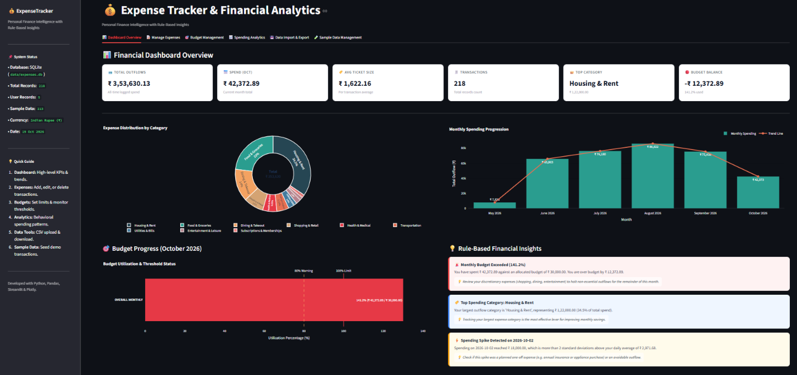
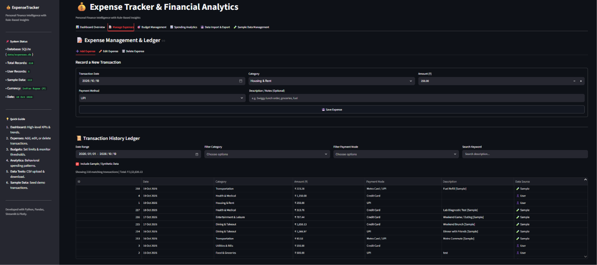
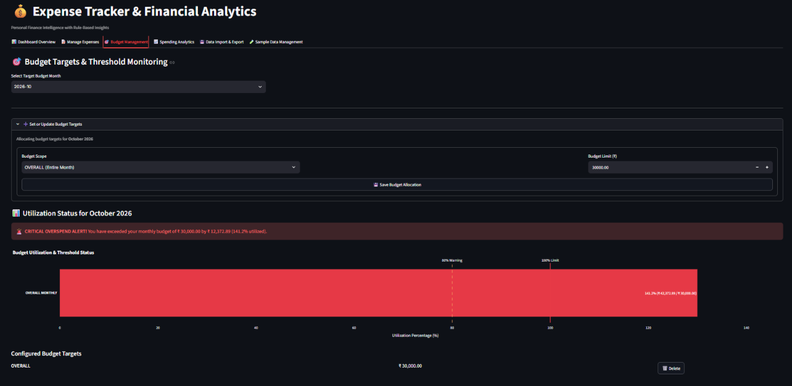
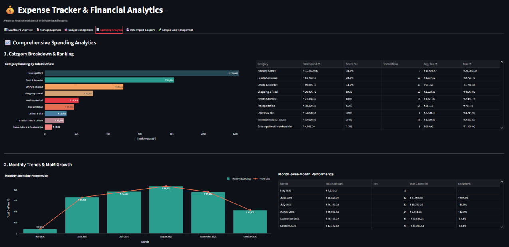
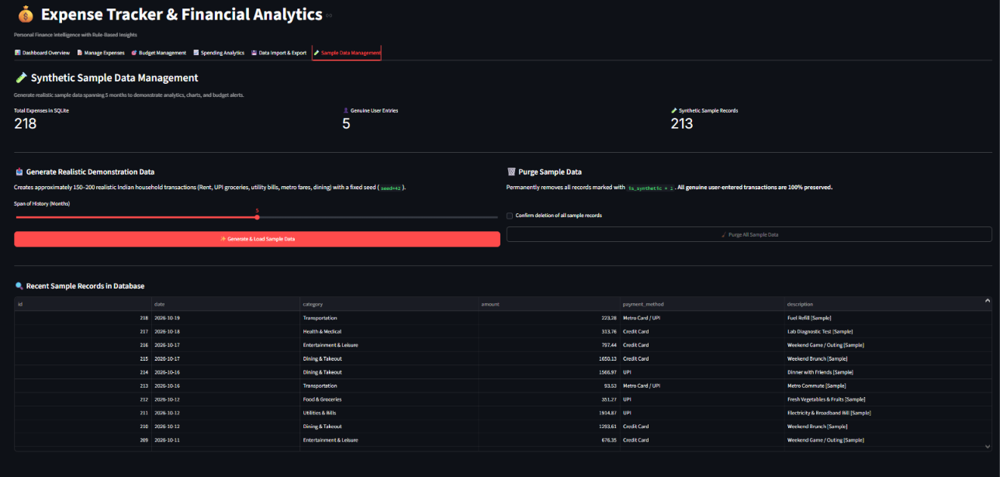

# 💰 Expense Tracker App Using Data Science

[](https://www.python.org/)
[](https://streamlit.io/)
[](https://plotly.com/)
[](https://www.sqlite.org/)
[](https://docs.pytest.org/)
[](https://opensource.org/licenses/MIT)

A placement-ready, industry-oriented personal finance intelligence and expense analytics web application. Built for aspiring **Data Analysts, Business Analysts, and Financial Analysts**, this application demonstrates the complete lifecycle of financial data: from relational persistence (SQLite) and data cleaning to Pandas aggregations, Plotly interactive visualizations, and deterministic rule-based financial advisory heuristics.

---

## 📌 Executive Summary & Key Highlights

* **100% Dynamic Financial Calculations:** Zero hardcoding. All KPIs, moving averages, category shares, and Month-over-Month (MoM) growth rates are derived dynamically in-memory from active SQLite database records.
* **Tiered Budgeting & Threshold Alerts:** Supports overall monthly budget caps and category-level limits with automated warnings at 80% utilization and critical overspending alerts at 100%.
* **Rule-Based Financial Insights:** Built-in heuristic algorithms detect high discretionary spending (>40%), single-category budget dominance, and daily spending spikes (>2 standard deviations above historical mean).
* **Reproducible Demonstration Mode:** Includes a deterministic synthetic data generator (`seed=42`) spanning 5 months of realistic Indian spending patterns (UPI groceries, Swiggy/Zomato, utility bills, rent) with a single-click purge option that preserves genuine user data.
* **Resilient CSV Ingestion:** Intelligent schema aliasing and validation for date parsing, currency symbol removal, and duplicate detection.
* **Indian Rupee Formatting:** Localized currency formatting (`₹ 1,23,456.78`) across all charts, KPI cards, and reports.
* **Fully Local & Private:** Operates entirely locally without external API keys, bank account connections, or cloud service dependencies.

---

## 🏗️ Architecture & System Data Flow

The application adheres to a clean, modular **Separation of Concerns (SoC)** architecture:

```text
Expense Input (Manual / CSV / Synthetic)
                  ↓
   Validation & Sanitization Layer
                  ↓
      SQLite Persistent Storage
                  ↓
       Pandas Processing Engine
                  ↓
   Analytics & Insights Derivation
                  ↓
     Plotly Interactive Charts
                  ↓
     Streamlit Web Application
```

### Modular Directory Structure

```text
Expense-Tracker-App/
│
├── data/                      # Local SQLite database (expenses.db) & temporary files
├── notebooks/                 # Exploratory data analysis (EDA) notebooks
├── outputs/                   # Exported CSV reports and summaries
├── Screenshots/               # UI screenshots and demonstration media
├── tests/                     # Pytest automated test suite (44 unit/integration tests)
│   ├── conftest.py            # Temporary isolated in-memory DB fixtures
│   ├── test_database.py       # DDL schema, tables & SQL constraints
│   ├── test_expense_service.py# CRUD operations, filtering & persistence
│   ├── test_validation.py     # Boundary validation & CSV cleaner tests
│   ├── test_budget_service.py # Budget allocations & 80%/100% alert tests
│   ├── test_analytics.py      # KPIs, category summaries & MoM growth tests
│   ├── test_insights.py       # Rule-based heuristics & spike tests
│   ├── test_synthetic_data.py # Reproducibility & sample data protection
│   └── test_data_io.py        # CSV export & template generation tests
│
├── src/                       # Application Source Code
│   ├── config.py              # Constants, categories, payment methods, thresholds
│   ├── database/              # SQLite connection pool & DDL schema auto-init
│   ├── models/                # Dataclass entity schemas (Expense, Budget)
│   ├── validation/            # Field-level & CSV batch validation
│   ├── services/              # CRUD, budget engine, synthetic generator, CSV I/O
│   ├── analytics/             # Aggregations, daily/monthly trends, financial insights
│   ├── visualization/         # Plotly donut charts, trendlines, and budget gauges
│   ├── ui/                    # Streamlit views (Dashboard, Expenses, Budgets, etc.)
│   └── utils/                 # Indian Rupee (₹) and date formatters
│
├── .gitignore                 # Excludes *.db, caches, virtual environments
├── README.md                  # Comprehensive installation & architecture manual
├── requirements.txt           # Pinned approved Python dependencies
└── main.py                    # Streamlit application entry point
```

---

## 🛠️ Approved Technology Stack

| Layer | Component | Version / Library | Purpose |
| :--- | :--- | :--- | :--- |
| **Runtime** | Python | 3.10+ / 3.11 | Core business logic and type safety |
| **Frontend UI** | Streamlit | `>= 1.35.0` | Multi-tab interactive web interface |
| **Data Processing** | Pandas & NumPy | `>= 2.0.0` / `>= 1.24.0` | In-memory aggregations, time-series rolling averages, matrix pivoting |
| **Visualizations** | Plotly | `>= 5.18.0` | Interactive Donut, Grouped Bar, and Gauge charts |
| **Database** | SQLite3 | Standard Library | Zero-configuration local relational persistence |
| **Testing** | Pytest | `>= 8.0.0` | 44 automated unit and integration tests |

---

## 🚀 Beginner-Friendly Installation & Setup Guide

Follow these exact step-by-step instructions to run the application on your local machine.

### Step 1: Verify Python Installation
Ensure you have Python 3.10, 3.11, or newer installed.

* **Windows (PowerShell):**
  ```powershell
  python --version
  ```
* **macOS / Linux (Terminal):**
  ```bash
  python3 --version
  ```
* *If not installed:* Download Python from [python.org](https://www.python.org/) (ensure **"Add Python to PATH"** is checked on Windows).

### Step 2: Open Project in VS Code
1. Launch **Visual Studio Code**.
2. Select **File > Open Folder...** and choose the `Expense Tracker App` directory.
3. Open the integrated terminal (`Ctrl + ~` or **Terminal > New Terminal**).

### Step 3: Create a Virtual Environment
Isolate project dependencies from your system Python.

* **Windows (PowerShell):**
  ```powershell
  python -m venv venv
  ```
* **macOS / Linux:**
  ```bash
  python3 -m venv venv
  ```

### Step 4: Activate the Virtual Environment
* **Windows (PowerShell):**
  ```powershell
  .\venv\Scripts\Activate.ps1
  ```
  *(Note: If you encounter an execution policy error on Windows, run `Set-ExecutionPolicy -Scope Process -ExecutionPolicy Bypass` and then run the command again).*
* **macOS / Linux:**
  ```bash
  source venv/bin/activate
  ```

### Step 5: Install Dependencies
Install all required libraries using `requirements.txt`:
```bash
pip install -r requirements.txt
```

### Step 6: Verify Database Auto-Initialization
The SQLite database at `data/expenses.db` initializes automatically on first app startup. You can also manually trigger initialization by running:
```bash
python -c "from src.database.schema import init_db; init_db(); print('Database schema initialized!')"
```

### Step 7: Launch the Application
Run the Streamlit application:
```bash
streamlit run main.py
```
Streamlit will automatically open the application in your default web browser at `http://localhost:8501`.

### Step 8: Run Automated Tests
Execute the full test suite with Pytest:
```bash
python -m pytest tests -v
```
All **44 test cases** should pass in approximately 1 second.

---

## 🔍 Troubleshooting Common Issues

| Error / Issue | Root Cause | Solution |
| :--- | :--- | :--- |
| `Script execution disabled` (Windows) | PowerShell execution policy restriction | Run `Set-ExecutionPolicy -Scope Process -ExecutionPolicy Bypass` in your terminal, then activate `venv`. |
| `ModuleNotFoundError: No module named 'src'` | Running script outside root directory | Ensure your terminal is in the project root directory (`Expense Tracker App`). Run scripts using `python -m pytest` or `streamlit run main.py`. |
| `Port 8501 is already in use` | Another Streamlit process is running | Run on a different port: `streamlit run main.py --server.port 8502`. |
| `database is locked` | Simultaneous non-WAL connections | WAL mode is enabled by default in `src/database/connection.py`. Close any external SQLite GUI tools if you have the file open in write mode. |

---

## 📸 Application Module & Visual Overview

| View / Module | Screenshot File | Key Analytical Highlights | Section Link |
| :--- | :--- | :--- | :---: |
| **1. Dashboard Overview** | [`Screenshots/01_Dashboard.png`](Screenshots/01_Dashboard.png) | 6 Live KPI cards, Category Distribution Donut with center total, Monthly progression trendline, real-time budget balance. | [View Section ↓](#1--interactive-dashboard-overview) |
| **2. Expense Management** | [`Screenshots/02_Manage.png`](Screenshots/02_Manage.png) | Full CRUD transaction ledger with `🧪 Sample` vs `👤 User` badges, search filter, and Indian Rupee (`₹`) formatting. | [View Section ↓](#2--expense-management-ledger--entry) |
| **3. Budget Targets & Alerts** | [`Screenshots/03_Traget.png`](Screenshots/03_Traget.png) | Tiered budget utilization progress bars, `⚠️ BUDGET WARNING` at 80% threshold, and `🚨 CRITICAL OVERSPEND` alerts. | [View Section ↓](#3--budget-management--real-time-alerts) |
| **4. Spending Analytics** | [`Screenshots/04_Analysis.png`](Screenshots/04_Analysis.png) | Horizontal category ranking bars, granular metrics table, Month-over-Month (MoM) growth %, and dual-month comparisons. | [View Section ↓](#4--spending-analytics--category-breakdown) |
| **5. Synthetic Data Engine** | [`Screenshots/05_Sample_Data.png`](Screenshots/05_Sample_Data.png) | Reproducible 5-month demo data generator (`seed=42`), data origin counts, and single-click clean purge safeguard. | [View Section ↓](#6--synthetic-demonstration-data-engine) |

---

## 📊 Application Functional Overview & Screenshots

### 1. 📊 Interactive Dashboard Overview
<p align="center">
  
</p>

* **6 Live Dynamic KPI Cards:**
  * **Total Outflow:** Overall spending tracked in the database.
  * **Current Month Spend:** Filtered spending for the active calendar month.
  * **Average Ticket Size:** Mean spend per transaction.
  * **Transaction Count:** Total recorded entries across user and demo data.
  * **Top Spending Category:** Largest expense category by total rupee volume.
  * **Remaining Budget Balance:** Net surplus/deficit calculated against active monthly budget caps.
* **Interactive Category Donut Chart:** Built with Plotly with donut hole display showing grand total and custom tooltip formatting in Indian Rupees (`₹`).
* **Monthly Progression Trendline:** Smooth area curve showing spending trends across historical months.
* **Live Budget Utilization Meter:** Real-time gauge progress bar displaying budget consumption with instant threshold coloring.
* **Heuristic Financial Alerts:** Surfaces top actionable alerts (e.g., high discretionary spend, category dominance).

---

### 2. 📝 Expense Management Ledger & Entry
<p align="center">
  
</p>

* **Add New Expense:** Responsive input form with robust client- and service-level validation:
  * Strict positive amount constraint ($> 0$).
  * Non-future date validation (cannot log expenses in future dates).
  * Category assignment (Essential Needs vs. Discretionary Wants).
  * Payment method tracking (UPI, Credit Card, Debit Card, Net Banking, Cash).
* **Interactive Transaction Ledger:** High-density, sortable, and filterable data grid.
* **Data Origin Badging:** Distinctive visual badges (`🧪 Sample` vs. `👤 User`) so genuine transactions are clearly distinguishable from simulated records.
* **CRUD Capabilities:** Inline Edit mode with pre-populated fields and secure Delete mode with confirmation safeguards.

---

### 3. 🎯 Budget Management & Real-Time Alerts
<p align="center">
  
</p>

* **Flexible Budget Configuration:** Set overall monthly spending limits and category-specific budget ceilings.
* **Dynamic Utilization Formula:**
  $$\text{Utilization \%} = \left(\frac{\text{Actual Expense Spend}}{\text{Allocated Monthly Budget}}\right) \times 100$$
* **3-Tier Visual Alert Engine:**
  * 🟢 **Normal Track (< 80%):** Standard progress bar, spending within safe bounds.
  * 🟡 **Budget Warning (80.0% – 99.9%):** Amber warning indicator alerting the user before the limit is breached.
  * 🔴 **Critical Overspend (≥ 100.0%):** High-priority red alert displaying the exact overspent rupee deficit.

---

### 4. 📈 Spending Analytics & Category Breakdown
<p align="center">
  
</p>

* **Horizontal Category Ranking:** Color-coded ranking bar chart clearly displaying top spending drivers.
* **Granular Statistical Summary:** Tabular summary displaying:
  * Total Rupee Outflow per category.
  * Exact percentage share of total budget (summing to 100.0%).
  * Average ticket size and maximum single transaction amount.
* **Month-over-Month (MoM) Growth Analysis:** Time-series delta calculations showing month-over-month variances in both absolute rupees (₹) and percentage (+/- %).
* **Dual-Month Comparative Bar Chart:** Clustered comparison chart enabling side-by-side behavioral audits between any two selected billing cycles.
* **50/30/20 Rule Analysis:** Categorizes expenditures into Essential Needs vs. Discretionary Wants.

---

### 5. 💾 Data Import & Export Engine
* **CSV Ingestion:** Upload CSV with automatic header aliasing (`Date`, `Category`, `Amount`, `Payment Method`, `Description`).
* **Validation & Cleaning Pipeline:**
  * Auto-detection and parsing of ISO `YYYY-MM-DD`, `DD-MM-YYYY`, and `MM/DD/YYYY` formats.
  * Strips currency symbols (`₹`, `$`, `,`) and coerces strings to floating-point numbers.
  * Identifies and flags potential duplicate transactions.
* **Export Filtered Reports:** Single-click export of database transactions to clean, standards-compliant CSV files filtered by date range and category.
* **Downloadable Starter Template:** Built-in sample CSV template for quick onboarding.

---

### 6. 🧪 Synthetic Demonstration Data Engine
<p align="center">
  
</p>

* **Deterministic Data Generation:** Uses NumPy with fixed seed (`seed=42`) to produce consistent, realistic financial histories spanning up to 5 months.
* **Realistic Indian Spending Profiles:** Simulates daily life patterns including rent payments on the 1st, utility bills, groceries, Swiggy/Zomato food orders, and shopping.
* **Sample Data Isolation:** All generated entries are tagged with `is_synthetic = 1` and `[Sample]` in the description.
* **One-Click Clean Purge:** Dedicated **"Purge All Sample Data"** action that wipes simulated records in one query while guaranteeing zero loss of genuine user records.

---

## 🧪 Automated Testing Verification

The project includes 44 unit and integration tests across 8 test suites:

```text
tests/test_database.py          4 passed (DDL tables, idempotent init, check constraints)
tests/test_expense_service.py   6 passed (CRUD, filtering, bulk inserts, synthetic purging)
tests/test_validation.py       14 passed (Positive amount, non-future date, CSV aliasing, duplicates)
tests/test_budget_service.py    5 passed (Allocations, 80% warning, 100% critical alert, deletion)
tests/test_analytics.py         6 passed (KPIs, category totals, MoM math, daily rolling avg)
tests/test_insights.py          3 passed (Heuristic triggers, spike detection, discretionary alerts)
tests/test_synthetic_data.py    3 passed (Reproducibility, attribute checks, duplicate protection)
tests/test_data_io.py           2 passed (CSV export serialization, template format)
============================== 44 passed in 1.15s ==============================
```

---

## 🧪 12-Step Live Demonstration & Simulation Walkthrough

Follow this step-by-step simulation protocol for recruiter demonstrations, technical portfolio reviews, or college viva evaluations:

### Step 1: Initialize the Application
1. Launch the application in your terminal:
   ```bash
   streamlit run main.py
   ```
2. Confirm the SQLite database file `data/expenses.db` auto-initializes on startup.
3. Observe the initial state: Onboarding guidance is displayed if no transactions exist.

### Step 2: Generate Synthetic Demonstration Data
1. Navigate to the **🧪 Sample Data Management** tab.
2. Review the data metrics: Note `Genuine User Entries` and `Synthetic Sample Records`.
3. Set the slider to **5 Months** and click **✨ Generate & Load Sample Data**.
4. The system executes `seed_synthetic_data_into_db(seed=42)` and loads realistic transactions spanning 5 months.
5. All transactions are tagged with `is_synthetic = 1` and contain `[Sample]` in descriptions.
6. Clicking the button again verifies duplicate protection.

### Step 3: Inspect the Dataset
1. Switch to the **📝 Manage Expenses** tab.
2. Scroll to the **Transaction History Ledger**.
3. Verify transactions are listed chronologically descending with `🧪 Sample` badges.
4. Filter by category (e.g., `Food & Groceries`): Confirm the ledger dynamically updates row counts and the aggregate sum in Indian Rupees (`₹`).

### Step 4: Clean and Validate Data
1. In the **Manage Expenses** tab, attempt invalid inputs in the **➕ Add Expense** form:
   * **Amount:** `-500` or `0` ➔ Error: *"Amount must be strictly greater than zero."*
   * **Date:** Future date ➔ Error: *"Date cannot be in the future."*
   * **Amount:** `150000000` ➔ Error: *"Amount exceeds the maximum permissible limit."*
2. Record a valid transaction:
   * **Date:** Today | **Category:** `Food & Groceries` | **Amount:** `1,250.00` | **Payment Method:** `UPI` | **Description:** `Weekend supermarket shopping`
3. Click **💾 Save Expense**: Confirm the instant ledger update with the `👤 User` badge.

### Step 5: Analyze Categories
1. Switch to the **📈 Spending Analytics** tab.
2. Inspect Section 1: **Category Ranking Bar Chart** and **Granular Summary Table**.
3. Verify:
   * Total spend per category.
   * Percentage share (%) summing to exactly 100.0%.
   * Average transaction size and maximum single transaction amount.

### Step 6: Analyze Monthly Trends
1. In the **Spending Analytics** tab, inspect Section 2: **Monthly Trends & MoM Growth**.
2. Examine the Month-over-Month table for absolute rupee differences (`+₹` / `-₹`) and percentage variance (`+12.4%` / `-8.5%`).
3. Select two different months in the dropdowns to view the clustered comparative bar chart.

### Step 7: Simulate Budget Overspending (Reproducible Demo)
1. Navigate to the **🎯 Budget Management** tab.
2. Select the current month and set an **Overall Monthly Budget** limit of **₹ 20,000.00**.
3. Add expenses under the current month in **📝 Manage Expenses**:
   * **Phase A — Normal Utilization (< 80%):** Add `₹ 10,000` ➔ Utilization is **50.0%** (🟢 Green progress bar).
   * **Phase B — Warning Threshold (80% – 99.9%):** Add `₹ 6,500` (Total = ₹ 16,500) ➔ Utilization is **82.5%** (🟡 Amber warning banner).
   * **Phase C — Critical Overspend (≥ 100%):** Add `₹ 5,000` (Total = ₹ 21,500) ➔ Utilization reaches **107.5%** with a **🚨 CRITICAL OVERSPEND ALERT** showing `-₹ 1,500.00` deficit.
4. Confirm the **Budget Balance** card on the **Dashboard Overview** reflects the deficit.

### Step 8: Generate Visualizations
1. Navigate between the **Dashboard** and **Spending Analytics** tabs.
2. Hover over the **Category Donut Chart** to view tooltips with rupee amounts and percentage shares.
3. Inspect the **Daily Spending Timeline** 7-day moving average curve.
4. Review the **Essential vs. Discretionary** lifestyle split (50/30/20 rule).

### Step 9: Test CSV Import and Export
1. Navigate to **💾 Data Import & Export**.
2. In **📄 Download Template**, download `expense_import_template.csv`.
3. In **📥 Import from CSV**, upload the template file. Confirm the validation summary (Total Rows, Valid Rows, Potential Duplicates).
4. Click **🚀 Commit Validated Rows to Database** for batch ingestion.
5. In **📤 Export to CSV**, select a date range and download the exported CSV report.

### Step 10: Verify Persistence
1. Note the total transaction count in the sidebar.
2. Stop the Streamlit server (`Ctrl + C`) and restart it (`streamlit run main.py`).
3. Confirm all records remain intact in `data/expenses.db`.

### Step 11: Run Automated Tests
1. In the terminal, execute:
   ```bash
   python -m pytest tests -v
   ```
2. Verify all **44 test cases pass with green status** in ~1 second.

### Step 12: Review Final Output & Sample Purge
1. Navigate to **🧪 Sample Data Management**.
2. Check **Confirm deletion** and click **🧹 Purge All Sample Data**.
3. Confirm: All synthetic records are cleared, while genuine user-entered transactions created in Step 4 and Step 7 remain safely preserved.

---

## 🎓 Portfolio & Interview Defense Guide

When presenting this project to interviewers:
1. **Explain the Architecture:** Emphasize that business logic, SQL operations, and visualizations are decoupled into dedicated service modules rather than crammed into one Streamlit script.
2. **Highlight Data Integrity:** Point to the automated test suite (`tests/`), SQLite `CHECK(amount > 0)` constraints, and the resilient CSV ingestion engine.
3. **Discuss Financial Modeling:** Explain the rule-based heuristic engine: 50-30-20 essential vs discretionary split, MoM percentage changes, and statistical anomaly detection ($> \mu + 2\sigma$).
4. **Demonstrate Demonstration Readiness:** Show how the synthetic data generator (`seed=42`) allows an interviewer to immediately explore the app with realistic data, and demonstrate the safety of the sample data purge function.

---

## 📄 License
This project is open-source under the [MIT License](https://opensource.org/licenses/MIT).
